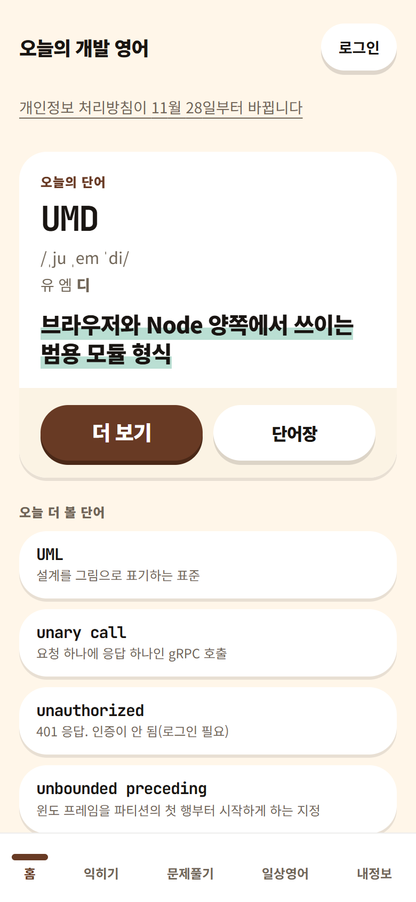
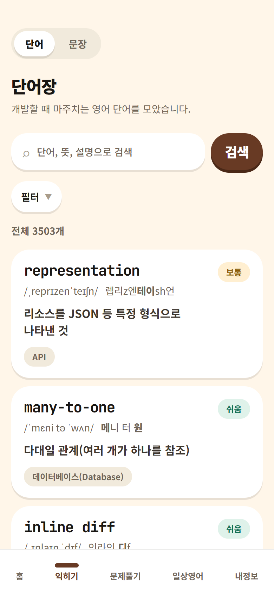
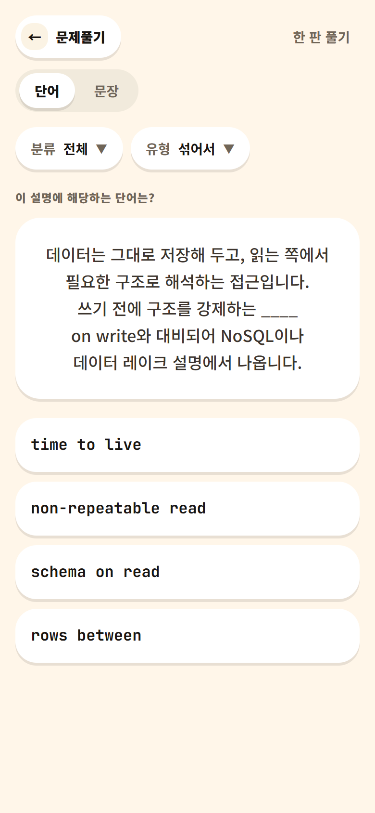
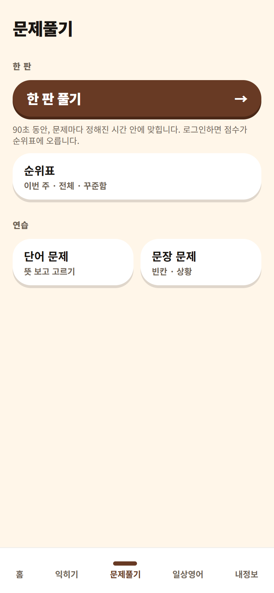
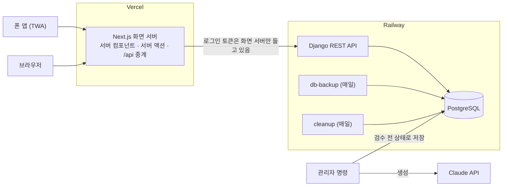

# DeVoca (devvoca)

주니어 개발자를 위한 개발 영어 학습 앱입니다. 코드와 문서, 에러 메시지에서 마주치는 영어 단어와 문장을 익히고 문제로 확인합니다. 정보처리기사를 준비하는 사람도 대상입니다.

- 웹: https://dev-voca.vercel.app
- 안드로이드 앱: 같은 웹을 주소창 없이 띄우는 TWA(Trusted Web Activity)로 감쌌습니다. `android/` 에 있습니다.

<p>
  
  
  
  
</p>

## 기능

- **익히기**: 개발 단어 3,503개와 예문 5,329개(2026-11 기준). 발음 기호와 한글 발음, 설명, 예문을 보여 주고 검색·분류·난이도로 거릅니다.
- **문제풀기**: 한 문제씩 푸는 연습(뜻 고르기, 설명 보고 단어 고르기, 문장 빈칸, 상황 고르기), 90초 동안 푸는 한 판과 순위표.
- **일일공부**: 하루 공부량을 고르면 단어를 카드로 익힌 뒤 바로 묻습니다. 틀렸던 단어를 먼저 다시 보여 줍니다.
- **복습과 오답 노트**: 틀린 단어와 오래 안 본 단어를 다시 묻고, 연속 두 번 맞히면 복습에서 빠집니다.
- **일상영어**: 문장을 소리 내어 읽으면 브라우저 음성 인식으로 맞게 읽었는지 봅니다.
- **회원**: 이메일 가입, 구글 로그인, 기기별 로그인 유지, 프로필 사진, 계정 삭제.

## 기술

| 영역 | 사용 |
|---|---|
| 백엔드 | Python 3.13, Django 5.2, Django REST framework |
| DB | PostgreSQL 18 (단어 검색은 부분 일치를 빠르게 찾는 pg_trgm 색인) |
| 화면 | Next.js 16 (App Router), React 19, TypeScript, Tailwind CSS |
| 앱 | Android TWA (구글의 TWA 앱 생성 도구 Bubblewrap) |
| 배포 | 백엔드·DB Railway, 화면 Vercel |
| 운영 | Sentry 오류 알림, 매일 DB 백업과 그 백업을 실제로 되살려 보는 검사, 1년 가까이 안 쓴 계정(메일로 미리 알린 뒤)과 만료된 로그인 기록을 지우는 새벽 정리 작업 |
| 콘텐츠 생성 | Anthropic Claude API (관리자 명령에서만) |

## 구조



브라우저는 백엔드를 직접 부르지 않습니다. 화면 서버(Next.js)가 로그인 토큰을 자바스크립트로 읽을 수 없는 쿠키(httpOnly)에 들고 있다가 대신 부릅니다. 화면에 스크립트가 끼어들어도 토큰을 꺼내 갈 수 없습니다.

## 설계에서 정한 것

- **AI 는 콘텐츠를 만들 때만 씁니다.** 관리자가 명령으로 단어 설명과 발음을 생성하면 "검수 전" 으로 저장됩니다. 관리자가 관리자 화면에서 내용을 확인하고 고친 뒤 검수 완료로 바꿔야 사용자에게 보입니다. 단어를 읽는 모든 조회는 검수 완료만 고르는 같은 조건을 거칩니다. 사용자가 화면을 열 때는 Claude API 를 부르지 않습니다. 그래서 비용과 응답 시간이 사용자 수에 묶이지 않습니다.
- **웹을 그대로 앱으로 냅니다.** 화면을 앱용으로 다시 만들지 않고 TWA 로 감쌌습니다. 기본 갈래(main)에 병합하면 Vercel 이 웹을 다시 배포하고, 그것이 곧 앱 업데이트라 스토어 심사를 기다리지 않습니다. 대신 웹 주소가 바뀌면 앱이 깨지므로 주소를 고정해 둡니다.
- **채점은 서버가 합니다.** 문제를 낼 때 서버가 문제 정보를 서버 비밀 키로 서명한 문자열(토큰)에 담아 주고, 정답은 그 안에 해시로만 들어 있어 화면에서 알아낼 수 없습니다. 걸린 시간도 서버 시계로 잽니다. 한 판에서 답할 때마다 순번을 DB 에 남겨서, 앞 문제의 토큰을 다시 보내 결과를 바꾸는 것을 막습니다.
- **로그인과 시도 제한.** 로그인 토큰은 기기마다 따로 내주고 30일이 지나면 끝납니다. 그 전에 화면 서버가 새 토큰으로 바꿔 받아 로그인을 이어 갑니다. 이미 새것으로 바뀐 옛 토큰이 다시 오면 누가 훔쳐 쓰는 것으로 보고 그 기기의 로그인을 끊습니다. 비밀번호를 대 보는 시도는 이메일마다, 접속 IP 마다 횟수를 세어 막습니다. 관리자 로그인은 전에 로그인해 본 적 없는 브라우저의 시도를 모두 합쳐 셉니다.
- **규모를 미리 재 봤습니다.** API 40개의 응답 시간을 하나씩 잰 뒤, 운영 데이터를 복사한 로컬 DB 에 단어·문장·일상 표현을 각각 100만 개(합계 300만 건)까지 채워 느려지는 곳을 찾아 고쳤습니다. 같은 DB 에서 코드만 고치기 전으로 돌려 비교하면, 많이 푼 계정의 오답 노트는 32.8초에서 10ms, 문장 문제(상황 고르기) 출제는 7.9초에서 12ms, 검색은 932ms 에서 14ms 로 줄었습니다(서버 안 처리 시간, 2026-11).
- **동시 접속도 재 봤습니다.** 운영 서버에 부하 시험 도구(k6)로 동시 200·500·1,000명을 걸어 보니, 500명부터 DB 보다 웹 작업자의 CPU 2개가 먼저 찼습니다. 요청 하나가 쓰는 CPU 를 프로파일링해 줄였고, 운영과 같은 자원(CPU 2개)을 로컬에 띄워 다시 재 보니 동시 300명에서 응답의 95% 가 오는 시간이 0.42초에서 0.03초로 줄었습니다(2026-11).

## 개발 방식

모든 변경은 기능 갈래(branch)에서 만들고, 병합 요청(pull request)으로 올리기 전에 네 가지를 거칩니다.
- 코드를 읽어 결함을 찾는 정적 검증
- 테스트를 새로 짜서 깨뜨려 보는 동적 테스트
- 코드 리뷰
- 폰 여덟 가지 크기(갤럭시 폴드 접음·펼침 포함)로 화면 확인

기본 갈래(`main`)는 보호되어 있습니다. 깃허브 자동 검사(CI)의 백엔드 테스트, 화면 테스트, 비밀값 유출 검사(GitGuardian)가 모두 통과해야 병합됩니다. 테스트는 백엔드 3,500여 개, 화면 4,000여 개입니다(2026-11). 개발에는 Claude Code 를 썼고, 작업 규칙은 `CLAUDE.md` 와 `.claude/` 에 있습니다.

## 로컬에서 실행하기

필요한 것: Python 3.13, Node.js 22, Docker.

```bash
# DB
docker compose up -d

# 백엔드
python -m venv .venv
source .venv/Scripts/activate # Windows Git Bash. macOS·Linux 는 source .venv/bin/activate
pip install -r requirements.txt
cp .env.example .env          # 로컬은 DJANGO_SECRET_KEY 와 POSTGRES_* 만 채우면 뜬다
cd backend
python manage.py migrate
python manage.py createsuperuser
python manage.py runserver

# 화면 (다른 터미널)
cd frontend
npm install
cp .env.example .env.local    # API_URL=http://127.0.0.1:8000
npm run dev
```

단어 데이터는 `backend/apps/vocab/management/commands/` 의 `seed_*` 명령으로 넣습니다.

## 테스트

```bash
cd backend && python manage.py test
cd frontend && npm test
```

## 폴더

```
backend/
  apps/accounts/      회원, 로그인, 계정 삭제
  apps/vocab/         단어·문장·일상 표현, 출제와 채점
  apps/learning/      학습 기록, 일일공부, 복습, 순위표
  apps/ai_pipeline/   Claude API 로 콘텐츠 생성 (관리자 명령)
  config/             설정
frontend/src/
  app/                화면과 /api 중계
  components/
  lib/                API 호출, 세션, 경로
android/              TWA 앱
DEPLOY.md             배포와 운영 절차
```
